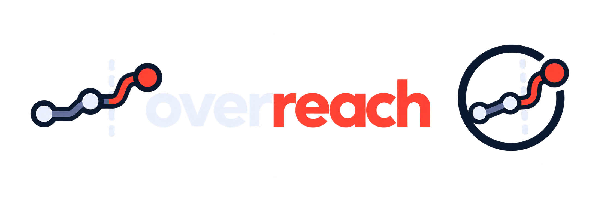

<p align="center">
  
</p>

<p align="center"><strong>Find out what your AI agents can be talked into doing with your APIs.</strong></p>

<p align="center">
  <a href="https://github.com/bogdanticu88/OverReach/actions/workflows/ci.yml"></a>
  
  
  
  
</p>

# Overreach

Overreach reads an API, works out the ways an AI agent using it could be steered
into harm by chaining together individually legitimate calls, says how strong
the evidence for each chain is, and ranks the smallest set of controls that would
break them.

> Status: pre-alpha, and honest about it. The full pipeline runs end to end on a
> bundled reference API, but the detection is still growing. `docs/SPIKE_NOTES.md`
> and `docs/baselines/comparison.md` show, with numbers, what it catches and what
> it still misses.

## The problem

APIs get reviewed one operation at a time. Is this endpoint authenticated, is
that one destructive, does this one leak data. Agents do not use APIs one
operation at a time. They chain calls, they read text that other people wrote,
and they act with whatever identity they were handed.

So an API can pass every per-endpoint check and still let a manipulated agent do
real damage in a few steps that each look harmless. An attacker writes a line
into an issue comment. The agent reads it while doing an ordinary task. Following
that text, the agent creates a webhook, or reads a file from another tenant, or
changes an account's email. No single call is a vulnerability. The sequence is.

Overreach looks for those sequences, from the attacker's text to the harmful
outcome, and treats the agent as what it is: a capable worker with no judgement
about what is off limits.

## What makes it different

Most tools in this space check tool descriptions for poisoned text, or lint a
spec one operation at a time. Overreach is built around three ideas those tools
do not combine:

**It is honest about evidence.** Nothing is called proven until it has been run.
A chain found in a spec is `hypothetical`. A chain that succeeded against a real
implementation, with a planted canary observed leaving, is `validated`. The
levels are enforced in the type system, so the tool cannot overclaim by accident.

**It reasons about authority, not just capability.** An optional boundaries file
says what the agent may do, which fields carry untrusted input, and which path
parameter marks a tenant. With it, Overreach scopes "any tool reachable" down to
what the agent can actually touch, and flags when a chain crosses a tenant or
ownership boundary. This is where a tenant-scoped read with no ownership check
shows up as cross-tenant data theft.

**It hands back fixes, not just findings.** The Breaker treats the chains as a
graph and works out a short, ranked list of controls that break them, each with
its coverage, effort, and whether it disturbs a legitimate workflow. "One change
stops all three chains" beats a wall of alerts.

## How it works

Five stages, each useful on its own, each feeding the next.

1. **Ingest.** Parse an OpenAPI 3.x spec safely. Nothing from the spec is ever
   executed, and external `$ref` targets are never fetched.
2. **Infer.** Work out what each operation really does (reads, writes, sends out,
   changes identity, destroys) and label every field by who can write it. Every
   effect carries a provenance (`declared`, `inferred`, `observed`) and a
   confidence, so the tool never pretends to know more than it does.
3. **Find chains.** Pair the places where untrusted text enters with the
   operations that cause harm, and search for the paths between them.
4. **Break them.** Compute the ranked control options that cut the chains.
5. **Prove them.** Against a real implementation, run the chain with canary data
   and watch whether the canary leaves. Only then does a chain become `validated`.

## Install

```bash
pip install -e ".[dev]"
```

## Use it

```bash
overreach profile <spec>                     # what the tool sees in a spec
overreach scan <spec>                        # find chains and ranked fixes
overreach scan <spec> --boundaries <file>    # scope findings to the agent's authority
overreach scan <spec> --sarif out.sarif      # SARIF for GitHub code scanning
overreach scan <spec> --html report.html     # a shareable HTML report
overreach scan <spec> --fail-on error        # non-zero exit, for CI gating
overreach validate                           # run the bundled reference demo end to end
```

## The demo

`overreach validate` scans a bundled reference API, a small code host written to
score well on agent-readiness linters, then proves chains by executing them:

```
Reference API: 3 finding(s) (scoped by the bundled boundaries file).

[df301d8e0d43] data_theft: VALIDATED
    ... the agent reads attacker text in a comment, then reaches
    POST /repos/{owner}/{repo}/hooks in 2 steps, each individually permitted.
    proof: canary reached the attacker destination through the webhook

[a3af9754ae4d] data_theft: VALIDATED
    ... the agent reaches GET /repos/{owner}/{repo}/contents/{path} ...
    Boundary crossed: crosses tenant boundary: no ownership check for 'owner'.
    proof: agent read another tenant's private file; no ownership check
```

A clean linter score next to a proven, two-step breach is the whole point.

## Evidence levels

| Level | Meaning | What it may claim |
| --- | --- | --- |
| `hypothetical` | A chain inferred from the specification | Worth investigating |
| `simulated` | Succeeded against a generated model of the API | Plausible, the real API may have checks the spec does not show |
| `validated` | Succeeded against an authorised real implementation | The tested implementation is vulnerable |

A chain found in a real third-party spec stays `hypothetical` until someone
validates it against an authorised instance. The tool does not blur that line.

## How good is it

Overreach is measured against independent baselines. Two reviewers with no
knowledge of the tool each hand-wrote the attack chains they would expect in two
real products, from the operation list alone. The finder is then scored against
those baselines (`docs/baselines/`). Current recall is 17 of 20 on one and 13 of
20 on the other, and the misses are written down as a roadmap rather than hidden.
Running on those real specs is also what found and fixed several precision bugs,
recorded in `docs/SPIKE_NOTES.md`.

## Safety

Overreach is built to be pointed at hostile input, because it will be. It never
executes or fetches anything from a spec, parses YAML in safe mode only, bounds
size and reference depth, and keeps any execution to an authorised target. Model
output, when a model is used, is schema-validated and never outranks a
deterministic rule. See `SECURITY.md`.

## Roadmap

Known gaps, in rough priority: code-execution and plugin-install effects,
configuration tampering, visibility and ownership changes, cross-org federation
sinks, and a model pass for the effects the rules are unsure about. The honest
backlog lives in `docs/baselines/comparison.md`.

## Contributing

See `CONTRIBUTING.md`. New attack patterns come with a test, the type check and
tests stay green, and nothing ever executes input.

## License

Overreach is free software under the GNU AGPL-3.0 (see `LICENSE`). A separate
commercial edition and hosted service are also offered; `CONTRIBUTING.md`
explains how contributions are licensed so both remain possible.

Copyright (C) 2026 Mihai-Bogdan Ticu.
